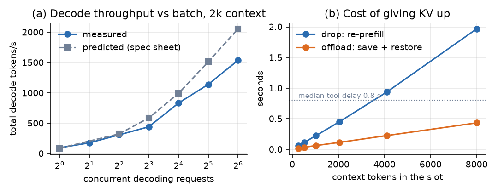
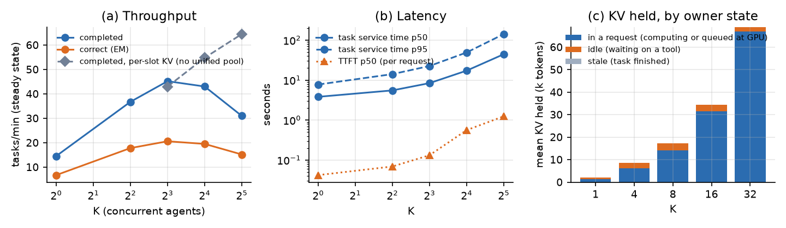
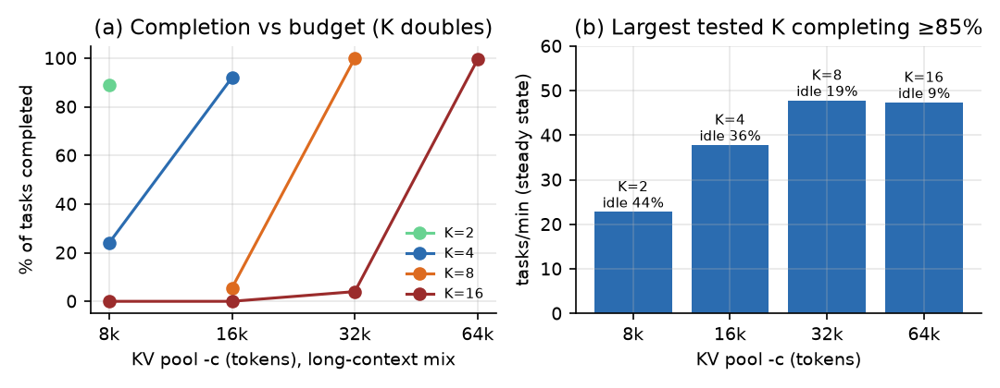
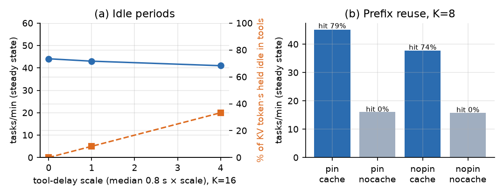
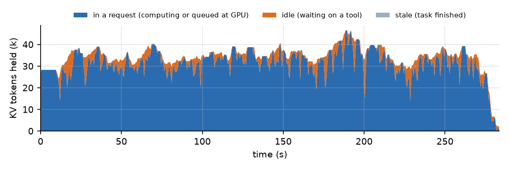
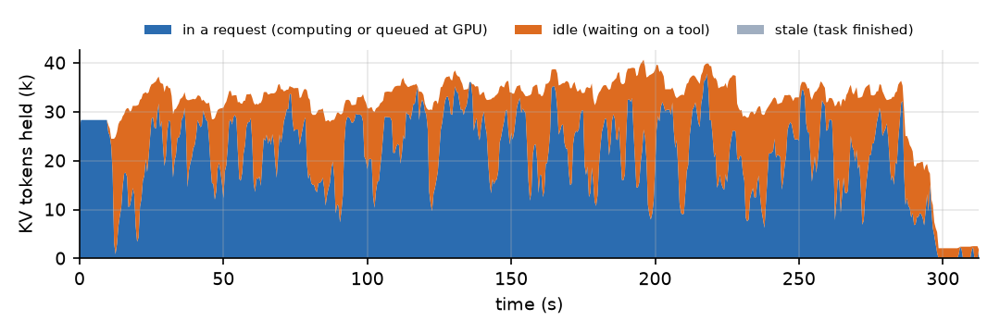

# Phase 1 Technical Notes: Memory-Aware Agent Edge Serving

Full measurements, runtime probes, cost model and reproduction steps behind the 2-page Phase 1
report (`phase1/report.tex`, PDF: `phase1_report.pdf`). Raw data is in `results/`.

## 1. Problem and question

Many tool-using agents share one GPU that serves a local 7B model. Each agent answers a
HotpotQA multi-hop question with a ReAct loop: an LLM call, a `search`/`lookup` tool call, the
next LLM call, and so on. While a tool runs, the agent's KV cache stays in the GPU pool, unused,
but it is needed again a second later.

**RQ1: under this workload and a bounded KV budget, what limits completed agent work?** The
candidates are (a) KV capacity for *active* requests, (b) KV held by agents that are *idle* in tool
calls, (c) *re-prefill* after the runtime evicts a context, and (d) the GPU itself, if KV never binds.

Phase 1 answers this with a reproducible instrumented workload, a FIFO fixed-concurrency baseline,
microbenchmarks and runtime probes that calibrate a first-principles cost model, and sweeps over
concurrency, KV budget, tool latency and prefix reuse (E1–E5).

## 2. Workload

- **Data.** HotpotQA distractor validation set (7,405 questions). Fixed, disjoint splits stratified by
  question type (seed 0): dev (200) for tuning, test (500) for the final report, and a perf split
  (1,500) for performance sweeps that need more tasks than dev has. All Phase 1 sweeps run on perf.
- **Tools.** Offline corpus of every validation paragraph, deduplicated by title (66,581 pages).
  `search[entity]` matches a title (exact → normalized → qualifier removed → fuzzy); on a miss it
  returns the best BM25 full-text match. `lookup[keyword]` returns the next matching sentence.
  Every returned sentence carries a supporting-fact flag. The corpus is easier than full Wikipedia,
  so accuracy is only compared across our own configurations.
- **Prompt.** ChatML rendered once on the client. ReAct agents share a ≈1.4k-token prefix (rules and
  6 hand-written few-shot examples); `oneshot_long` has its own ≈55-token instructions. The agent
  then extends one assistant turn append-only (Thought / Action / Observation), so each step's prompt
  is a byte-prefix of the next and prefix reuse depends only on what the server keeps.
- **Agent.** ReAct v3, frozen for all experiments (dev-100 before the AWS runs: F1 0.64–0.65 vs 0.25
  closed-book, 0% parse errors, 16–19% of tasks forced to answer at the step cap).
- **Profiles.** Context sizes below were measured on 20 dev questions per profile before the AWS runs;
  §5.3 gives the A10G measurements.

| Profile | What it does | LLM calls | Context p50 / max | Output tokens/task |
|---|---|---|---|---|
| `react_short` | ReAct; search returns 3 sentences | 4.3 | 1.9k / 3.0k | 177 |
| `react_long` | ReAct; search returns whole paragraphs + BM25 neighbours | 3.5 | 3.4k / 5.3k | 129 |
| `react_explain` | `react_short` + a fixed 300-token explanation | 4.2 | 2.3k / 2.9k | 429 |
| `oneshot_long` | no tools; 10 own + 15 distractor paragraphs, one call | 1 | 3.6k / 4.7k | 48 |

  The default mix is 40/30/20/10% in that order; E2 uses a long-context mix (70% `react_long`,
  30% `react_short`).
- **Tool delays.** Lognormal, median 0.8 s, σ 0.6, capped at 5 s; `lookup` 0.1 s. Seeded by
  (seed, task, step, tool), so they do not depend on scheduling. The tool's own compute runs in a
  thread, overlapped with the delay; the measured wait exceeds the seeded delay by ≤ 2 ms at p95,
  so the client is not a bottleneck. A scale factor sweeps delays.
- **Arrivals.** Workloads are generated once and frozen to JSON. Closed-loop runs release all tasks at
  t = 0 to K workers; open-loop runs use Poisson arrivals.

## 3. Baseline and measurement

- **Runtime.** llama.cpp `llama-server` b11960 (commit 8642541, CUDA, sm_86) on an AWS g5.xlarge
  (NVIDIA A10G with 23,028 MiB; 4 vCPU; 16 GiB RAM). Qwen2.5-7B-Instruct Q4_K_M (4.36 GiB weights,
  56 KiB of f16 KV per token), temperature 0. Flags: `--kv-unified -c <budget> -np 64 -fa on
  -b 2048 -ub 512 --cache-ram 0`; the KV budget is `-c`. Model and precision (f16 KV) are fixed in
  every comparison.
- **Baseline.** One FIFO queue and K workers; a task holds its worker until it finishes. K is the fixed
  concurrency: the number of agents in flight. Worker k sends every request with `id_slot=k`,
  `cache_prompt=true`, so an agent's KV stays in its slot through tool calls ("always retain"). The
  unpinned variant (`-np = K`, server picks slots) is the runtime's default cache policy.
- **Instrumentation.** Per request: start, first token, end, prompt/cached/generated tokens and
  prefill/decode time. Per tool call: start, end, actual idle time. Per task: arrival, admission,
  completion, answer, EM/F1, supporting-fact recall, and the prompt ledger split into typed segments.
  Per run: server command line, build, workload hash and code revision; GPU memory, server RSS and
  `/metrics` every second. A sweep driver restarts the server for every run, so no cache state
  carries over. Requests time out after 600 s and tasks after 900 s; no run hit either.
- **KV occupancy.** The runtime has no KV gauge, so we rebuild each slot's token count over time from
  the per-request counts. Each slot-second is *in a request* (queued at the server, prefilling or
  decoding; the request's final size is charged for its whole duration), *idle* (the owner is between
  requests, i.e. in a tool call) or *stale* (the task finished; its KV stays until the slot's next task
  overwrites it). This is an upper bound on residency: it charges final sizes from request start and
  cannot see when the server evicts a slot. A *live-agent eviction* is a follow-up request that reuses
  less than 95% of what its slot held after the previous step; the difference is recomputed.
- **Metrics.** Steady-state throughput and goodput (EM-correct tasks/min) over the completions between
  the 10th and 90th percentile completion time, so ramp-up and the drain tail do not set the rate.
  Task service time (admission → completion) for closed-loop runs; latency (first and last 10% of
  arrivals excluded) and queue wait (all tasks) for open-loop runs; p50/p95/p99; TTFT; completed and
  failed tasks; cache hit rate; occupied KV tokens (mean, peak, share of token·seconds by state).
  GPU memory from `nvidia-smi` is constant within a run because the pool is preallocated, so it is set
  by `-c` alone; occupied KV tokens are the memory metric that differs between policies.
- **Checks.** 18 unit tests against a mock LLM. With pinned slots and an ample pool, every follow-up
  request reused ≥ 95% of its previous step's context (0 lost tokens over 580 follow-ups at K = 8).
  CUDA outputs are not batch-invariant: identical 20-task runs differed by up to 0.07 F1 (earlier local
  check), and three identical 200-task runs here by ±0.012, so we treat F1 differences below ~0.03 as noise.

## 4. Runtime characterization (M0, E0a)

### 4.1 What the runtime does (E0a)

Each probe starts its own server and talks to it over HTTP only; raw responses and server logs are
in `results/e0/`.

| Question | Finding | Consequence |
|---|---|---|
| Idle pinned slots exceed the pool? | No error: the server **purges idle slots** to make room, one at a time, always the **first idle slot by slot id** (`server-context.cpp:1910`, marked "TODO: smarter decision … LRU … move slot to level 2 cache … store and resume later"). | The default eviction ignores recency, size and whether the agent returns in a second. |
| *Active* requests exceed the pool? | Every in-flight request fails with HTTP 500 "Context size has been exceeded" (4/4 failed, though 2 would have fit). | Over-admission fails abruptly rather than slowing down. |
| Is a shared prompt prefix stored once? | No. Eight slots with the same 1,500-token prefix each prefill it themselves (first-request cache hit 0), and under an 8k pool five of eight lose it. | The ReAct prefix is duplicated per slot. |
| Per-slot context limit under `--kv-unified`? | None by default: one slot used 12k of a 16k pool with 8 slots. `--kv-unified-per-slot 4096` rejects a 6k prompt (HTTP 400). | The pool, not the slot count, is the budget. |
| Cost of `-np 64` vs `-np 4`, same `-c`? | Identical GPU memory (6,433 MiB) and decode speed (188 vs 188 tok/s). | We fix `-np 64` for pinned runs. |
| Slot save/restore cost? | M0 fit to `/dev/shm`: save 1.35 GB/s, restore 4.74 GB/s. In the stall probe a 3k-token slot (172 MB) took 99 ms to save and 41 ms to restore, and both run on the server's main loop: other slots' decoding stopped for up to 119 ms (normal token gap 20 ms). Restore into a *different* slot works (2,999/3,000 tokens reused). | Offload is cheaper than re-prefill for the agent but stalls every other agent. |
| HTTP starvation with 64 idle keep-alive connections? | No: `/health` 1.5 ms, slot save 4.7 ms. | Slot control is usable at K = 64. |

### 4.2 Microbenchmarks and the cost model (M0)

Before measuring, we wrote down predictions from spec-sheet numbers (`predictions/`, frozen
10/29); M0 then measured the same quantities (Figure 1).



*Figure 1. (a) Total decode throughput vs concurrent requests (2k-token contexts, a separate KV buffer
per sequence): measured vs predicted from spec-sheet bandwidth/FLOPs. (b) Cost of giving one agent's
KV up: re-prefill vs slot save + restore to host RAM, against the median tool delay.*

| Quantity | Predicted (spec) | Measured | Note |
|---|---|---|---|
| Single-stream decode, 2k context | 87 tok/s | 95 tok/s | Bandwidth-bound; context length matters little (99 → 90 tok/s from 0 to 8k) |
| Decode, 64 concurrent | 2,055 tok/s | 1,537 tok/s | Still rising at 64 (+35% from 32 → 64); our roofline is optimistic at high batch |
| Prefill | ≈2,400 tok/s | 4,550 tok/s | Re-prefill is about half as expensive as predicted |
| Re-prefill 2k / 8k tokens | 0.96 s / 3.6 s | 0.45 s / 1.97 s | |
| Offload round trip, 2k tokens | 11 ms (PCIe) | 113 ms | Slot save goes through a file, ~10× slower than PCIe, and blocks the server |
| Max resident agents (whole GPU) | 148 (short) / 42 (long) | 108 (3.0k peak) / 61 (5.3k peak) | Calibrated with measured contexts and GPU memory |

Two consequences carry into the results. First, with a separate KV buffer per sequence (how
llama-batched-bench runs by default), decode throughput keeps rising up to 64 concurrent requests:
the hardware rewards concurrency. §5.1 shows that the server's unified pool does not get this benefit.

Second, giving KV up costs about as much as holding it through a typical tool call. We price both in
pool token·seconds: holding S tokens idle costs S per second; offloading costs the agent's own transfer
plus the stall it imposes on the other K − 1 agents, B = (S + S_others)·(t_save + t_restore); the
break-even is T\* = B / S. This equivalence of held memory and stalled work is a modeling choice, not
a measurement. With measured costs, T\* at K = 16 is 1.7 s (`react_short`) to 3.0 s (`react_long`),
above ≈ 90% and ≈ 99% of tool delays respectively (`costmodel/calibrated.py`). Retaining is
therefore the right default; giving KV up pays only under memory pressure or for unusually long tool
calls, which motivates a pressure-gated policy in Phase 2.

## 5. Results

All sweeps run the mixed workload (40/30/20/10%) on the perf split unless stated: one run per point,
three at K = 8 and K = 16 (steady throughput varied by up to ±2.7% between repeats, F1 by ±0.012).
Every table gives completed tasks next to throughput.

### 5.1 E1: concurrency (ample KV pool)

Closed loop, `-c 131072` (KV never binds: peak 82k tokens at K = 32, no live-agent evictions). Peak GPU
memory is 11,929 MiB in every run and server RSS ≤ 1,147 MiB.



*Figure 2. (a) Steady-state throughput and goodput vs K, with the unified KV pool (solid) and with
per-slot KV regions (dashed, E1b). (b) Task service time (admission → completion) and per-request
TTFT. (c) Mean KV held, by what its owner is doing.*

| K | completed | tasks/min | correct/min | F1 | service p50 / p95 / p99 | TTFT p50 | mean KV held | idle share |
|---|---|---|---|---|---|---|---|---|
| 1 | 50/50 | 14.5 | 6.7 | 0.64† | 3.8 / 7.8 / 10.6 s | 0.04 s | 2.0k | 40% |
| 4 | 200/200 | 36.8 | 17.8 | 0.58 | 5.5 / 14.1 / 17.3 s | 0.07 s | 8.5k | 29% |
| **8** | 600/600 | **45.2** | **20.6** | 0.56 | 8.4 / 22.6 / 30.6 s | 0.13 s | 17.4k | 18% |
| 16 | 599/600 | 43.0 | 19.5 | 0.56 | 17.3 / 49.2 / 62.5 s | 0.56 s | 34.4k | 8% |
| 32 | 319/320‡ | 31.0 | 15.2 | 0.58 | 44.4 / 141.7 / 157.2 s | 1.24 s | 68.9k | 3% |

† K = 1 ran a 50-task subset; F1 is otherwise flat across K within noise. ‡ K = 32 ran 320 tasks so each
worker gets ≥ 10. p99 is from the first repeat. Failures here and below are the client keep-alive race (§8).

Among unified-pool configurations on this grid, K = 8 is best. Beyond it, throughput *falls*: K = 32
completes 31% fewer tasks per minute than K = 8. The GPU is busy almost all the time from K = 4 up
(`nvidia-smi` utilization ≥ 89%, which measures kernel occupancy, not saturation), the client is not a
bottleneck (§2), and the work per task is constant (≈1,750 prefilled and ≈200 decoded tokens). So each
unit of work got more expensive: the median time per generated token grew from 15 ms (K = 4) to
254 ms (K = 32), against 28 ms that M0 measures for 32 concurrent decodes.

**Cause: the unified KV pool.** With `--kv-unified` all slots share one KV buffer. Our explanation,
consistent with the measurements below though we have not traced the kernels, is that each attention
call spans the occupied part of that buffer with other slots' tokens masked, so its cost grows with
everyone's tokens, not just the slot's own. llama-batched-bench shows the effect directly: at batch 16,
prefill drops from 4,578 tok/s (separate buffers) to 2,776 tok/s (unified), and to 1,954 at batch 32;
decode drops 7% at batch 16 and 30% at batch 32. Rerunning E1 with per-slot KV regions
(`--no-kv-unified`, E1b, `-np = K`, which E0a found has no cost by itself) removes the collapse:
54.8 tasks/min at K = 16 (+27%, with the same 131k-token pool and 11,803 vs 11,929 MiB) and 64.5 at
K = 32 (×2.1). At K = 8 it is no faster (43.0 vs 45.2). F1 is unchanged. The price is flexibility:
per-slot regions are reserved up front (8,192 tokens each), a slot can never use more than its region,
and K = 32 needed a 262k-token pool (18,971 MiB) where the unified pool used 131k (11,929 MiB).

This is the central Phase 1 observation: **in the runtime's memory-flexible mode, attention cost
grows with the tokens resident in the shared pool**, which caps useful concurrency well below what the
hardware supports. Our measurements show it for tokens of active requests (E3 at zero tool delay, with
no idle KV at all, still runs at 44.1 vs 54.8 tasks/min). If the kernel spans every occupied cell, KV
held by idle or finished agents adds the same cost; we have not isolated that, and Phase 2 tests it by
holding idle slots resident at a fixed active load. A second consequence: at equal memory, per-slot KV
at K = 16 is the fastest simple configuration we measured, so Phase 2 includes it as a tuned baseline.

### 5.2 E1: open-loop arrivals

Poisson arrivals at K = 8, at 45%, 70% and 100% of its closed-loop capacity.

| Arrivals/min | completed | tasks/min | F1 | latency p50 / p95 / p99 | queue wait p95 | mean KV held (stale share) |
|---|---|---|---|---|---|---|
| 21 | 200/200 | 20.3 | 0.55 | 6.2 / 16.5 / 19.9 s | 0 s | 19.6k (72%) |
| 33 | 200/200 | 32.2 | 0.58 | 8.4 / 21.1 / 23.5 s | 4.1 s | 18.4k (47%) |
| 45 | 200/200 | 42.7 | 0.55 | 14.4 / 30.7 / 33.8 s | 13.8 s | 17.3k (8%) |

Below capacity the system keeps up; at capacity, queueing roughly doubles p95 latency, and the queue
does not reach a steady state, so its tail grows with run length (200 tasks here). Total KV held stays
at 17–20k tokens because pinned slots keep their last task's KV; at low load most of it (72% at
21 arrivals/min) is **stale** KV of finished tasks, while KV of live agents grows with load (≈ 5.6k →
16k tokens).

### 5.3 E2: KV budget and context growth

Long-context mix, closed loop, budgets 8k–64k tokens, K doubling from 2 to 16. GPU memory is
5,087 / 5,543 / 6,457 / 8,281 MiB for 8k / 16k / 32k / 64k.



*Figure 3. (a) Share of tasks completed vs KV budget, per K. (b) Throughput of the largest tested K that
completes ≥ 85% of tasks at each budget, with the share of its held KV that belongs to agents waiting
on tools.*

| `-c` | K | completed | tasks/min | F1 | mean / peak KV§ | idle share of held KV | server purges (log) | live-agent evictions |
|---|---|---|---|---|---|---|---|---|
| 8k | 2 | 178/200 | 22.8 | 0.52 | 4.7k / 8.5k | 44% | 5 | 2 |
| 8k | 4 | 48/200 | 13.1 | 0.13 | 6.6k / 9.5k | 45% | 57 | 12 |
| 16k | 4 | 184/200 | 37.8 | 0.56 | 9.5k / 16.3k | 36% | 3 | 0 |
| 16k | 8 | 11/200 | 3.6 | 0.03 | 12.3k / 17.6k | 36% | 24 | 4 |
| 32k | 8 | 200/200 | 47.8 | 0.59 | 20.2k / 30.5k | 19% | 0 | 0 |
| 32k | 16 | 8/200 | — | 0.03 | 24.5k / 32.4k | 33% | 9 | 0 |
| 64k | 16 | 199/200 | 47.3 | 0.59 | 37.7k / 52.1k | 9% | 0 | 0 |
| 8k, 16k | 16 | 0/200 | — | — | — | — | — | — |

§ Reconstructed occupancy is an upper bound (§3), which is why a few peaks exceed `-c`.

**Context growth drives the pressure.** A `react_long` agent starts at a median of 1,488 tokens and
reaches a median peak of 3,437 and a p95 peak of 6,226 (max 6,990): its KV grows 2.3× at the median
and 4.2× at the tail, about +700 tokens per step. `react_short` grows from 1,489 to 1,810 (p95 2,494),
`react_explain` from 1,698 to 2,274 (p95 3,247); `oneshot_long` arrives at its full 3,276. Admission
sized by an agent's first request therefore under-reserves by 2–4× for long tasks.

Three results:

- **Over-commitment fails abruptly.** Per request this is certain (E0a: all in-flight requests fail).
  On our power-of-two grid, doubling K past what the budget holds cut completion from 89–100% to
  ≤ 24%; we did not test intermediate K. Of the 972 E2 failures, 971 are the runtime's "Context size
  has been exceeded" (the other is the client race of §8): the failing requests' workers immediately
  start new tasks, which fail the same way. Purging idle slots does not prevent it.
- **The largest tested K that completes ≥ 85% of tasks is about budget / 4k tokens** for this mix, i.e.
  sized for the median peak plus headroom, and even these points lose 8–11% of tasks when several
  agents reach their tail peaks together. Small budgets therefore force K far below the compute-best
  K: 8k and 16k pools reach 48% and 80% of the throughput of 32k–64k pools.
- **At the small K these budgets force, 36–44% of the KV held belongs to agents waiting on tools**
  (about a quarter of the pool). This share is set by K, not by memory pressure: at K = 8 it is
  18–19% with or without a tight pool. Releasing it could admit more agents only if admission also
  reserves for every agent's growth to its peak, which Phase 2 tests.

Re-prefill after eviction (candidate c) was minor here: at most 12 live-agent evictions per run. Most
server purges hit slots of finished or failed tasks.

### 5.4 E3: idle periods between steps

K = 16, tool-delay scale 0, 1, 4 (median 0, 0.8, 3.2 s), ample pool.

| Delay scale | completed | tasks/min | F1 | KV token·s held idle in tools | mean KV held |
|---|---|---|---|---|---|
| 0 | 200/200 | 44.1 | 0.58 | 0.1% | 34.7k |
| 1 | 599/600 | 43.0 | 0.56 | 8% | 34.4k |
| 4 | 200/200 | 41.0 | 0.57 | 33% | 31.5k |

With an ample pool, a third of the KV can sit idle while throughput drops only 7%: other agents fill
the GPU while one waits. Idle KV matters when it displaces work, i.e. when the pool is full (E2).



*Figure 4. (a) E3: throughput and idle share of KV vs tool-delay scale (K = 16). (b) E4: prefix reuse
on/off with pinned slots vs llama.cpp's own slot assignment (K = 8).*

### 5.5 E4: does retained context matter?

K = 8, `-c 131072`; every configuration completed all its tasks with F1 0.56.

| Slots | Prefix cache | completed | tasks/min | cache hit | prefill tokens | TTFT p50 | service p50 |
|---|---|---|---|---|---|---|---|
| pinned (ours) | on | 600/600 | **45.2** | 79% | 0.34M | 0.13 s | 8.4 s |
| server-chosen (`-np = K`) | on | 200/200 | 37.7 | 74% | 0.45M | 0.16 s | 10.6 s |
| pinned | off | 200/200 | 16.1 | 0% | 1.69M | 1.30 s | 24.7 s |
| server-chosen | off | 200/200 | 15.9 | 0% | 1.72M | 1.42 s | 25.5 s |

Retained context matters a lot: without reuse every step re-prefills its whole context, prefill work
grows 4.9× and throughput falls to 36%, at equal quality. The runtime's own slot assignment loses 17%
against pinning: it placed 31% of returning agents' next steps on a different slot (180 of 585), which
re-prefilled ≈145k context tokens that pinning reuses (0 moves with pinning). E4 is an upper bound on
what eviction could cost; actual evictions were rare in Phase 1 (§5.3).

### 5.6 E5: what the KV holds

Token-level composition of finished contexts (Qwen2.5 tokenizer on each task's prompt ledger, E1
K = 8; K = 32 is within 2 points):

| Profile | mean tokens | shared prefix | thoughts/actions | supporting facts | other retrieved text | obs. framing | supporting facts / observation |
|---|---|---|---|---|---|---|---|
| `react_short` | 1,940 | 73% | 8% | 4% | 7% | 5% | 25% |
| `react_long` | 3,727 | 38% | 4% | 3% | 49% | 5% | 4.5% |
| `react_explain` | 2,429 | 67% | 18% | 4% | 5% | 3% | 30% |
| `oneshot_long` | 3,364 | 2% | 1% | 3% | 87% | 7% | 2.8% |

Two consequences. (1) The ≈1.4k-token ReAct prefix is most of a short agent's KV and is stored again in
every slot (E0a): ≈20k duplicated tokens at K = 16 with the default mix, a third of a 64k pool.
(2) In long contexts only 4.5% of retrieved tokens are evidence, which leaves room for selective
retention (Phase 3).

Over time (Figure 5), KV at K = 16 stays at 30–45k tokens, almost all of it in requests that are
running or queued at the GPU; at 4× tool delay a third of it is held by agents waiting on tools.




*Figure 5. KV tokens held over time by owner state: E1 K = 16 (top) and E3 with 4× tool delay
(bottom).*

## 6. The dominant bottleneck (RQ1)

The answer depends on whether the KV budget covers what K agents grow to.

1. **Ample KV: the unified pool's attention cost (d), not raw GPU capacity.** Throughput peaks at
   K = 8 (45 tasks/min) and falls after, because attention cost grows with the tokens resident in
   llama.cpp's unified pool (§5.1). Per-slot KV regions remove most of the collapse (+27% at K = 16
   with the same memory; ×2.1 at K = 32 with twice the pool) but reserve memory statically. Idle
   KV (b) is a K-dependent share (18% at K = 8, 3% at K = 32) and barely affects throughput here (E3).
2. **Tight KV: active capacity (a), failing abruptly.** When the budget is below what K agents grow
   to, over-committed active requests all fail at once (E0a, E2). Contexts grow 2–4× during a task
   (§5.3), so the fixed-K baseline must size K for peaks, far below the compute-best K.
3. **Re-prefill after eviction (c) was not a material bottleneck** in any Phase 1 run (≤ 12 live-agent
   evictions per run). E4 bounds it: if no context were ever reused, throughput would fall to 36%.
4. **Duplication inflates both regimes.** The ReAct prefix is stored once per slot (E0a), 38–73% of a
   ReAct agent's KV (E5).

So memory management can help where the KV budget, not the GPU, sets K, and in the unified pool,
keeping fewer tokens resident may also make the remaining work cheaper.

## 7. Implications for Phase 2

Phase 2 builds one mechanism, justified by these measurements: an agent-level KV lifecycle manager at
tool-call boundaries plus admission that reserves each agent's projected peak.

- **Admission must reserve projected peaks, not current size.** Over-commitment fails every in-flight
  request (E0a, E2), and contexts grow 2–4× during a task (§5.3).
- **Tuned baselines.** The largest safe fixed K per budget (unified pool), and the best per-slot
  configuration wherever per-slot regions fit the budget (§5.1). The runtime's own policy is a third:
  it evicts idle slots by slot id with no notion of who returns soon (llama.cpp marks this as a TODO),
  and its slot assignment re-prefills 31% of returning steps.
- **Retain by default; give KV up under pressure.** With measured costs the break-even T\* at K = 16
  (1.7–3.0 s) exceeds ≈ 90–99% of tool delays, so a pressure-gated policy that keeps KV unless memory
  is needed, then offloads or drops the agent expected to return last, is the design to test.
- **Test the second payoff directly.** Whether idle and stale KV slow other agents' attention in the
  unified pool (§5.1) is measured by holding N idle slots resident at a fixed active load.
- **Comparisons keep model and precision fixed**; unified and per-slot modes are reported side by side.

## 8. Limitations

- One run per point except K = 8 and 16 (steady throughput ±2.7% between repeats). The K and budget
  grids are powers of two, so optima and failure points between grid points are not resolved.
- E2 uses only the long-context mix; the budget/K rule is not measured for other mixes.
- 9 of 5,890 tasks (0.15%) across 29 runs failed with a client-side keep-alive race
  (`RemoteProtocolError`), not a capacity effect; the client fix lands at the start of Phase 2 so all
  Phase 1 runs use identical code.
- The A10G is larger than an edge GPU; memory pressure is created by capping `-c`, as the course
  allows. Tool delays are synthetic, and the offline corpus is easier than full Wikipedia. The profile
  table in §2 and the dev quality numbers come from runs before the AWS experiments.
- KV occupancy is reconstructed from request token counts and is an upper bound on what was resident.
- The unified-pool explanation in §5.1 is inferred from measurements, not from tracing the kernels.
- Runs record code revision `3bc14d2+dirty` (the Phase 1 code was not yet committed); the commit that
  contains it is listed in Appendix A.

## Appendix A: Reproducing

Code: branch `jiawei`, commit _[to be filled at submission]_. On a GPU host with llama.cpp b11960 built
with CUDA, set `LLAMA_SERVER`, `LLAMA_BIN` (its `build/bin`) and `MODEL` (the 7B Q4_K_M GGUF, first shard):

```
uv sync
scripts/download_hotpotqa.sh
uv run python -m scripts.build_corpus && uv run python -m scripts.build_splits
uv run python bench/e0_runtime.py                              # E0a       -> results/e0/
NPL=1,2,4,8,16,32,64 bench/run_microbench.sh a10g              # M0        -> results/microbench/
bench/unified_probe.sh                                         # unified vs separate KV buffers
CTX=16384 PARALLEL=1 PORT=8091 scripts/start_server.sh &       # then:
uv run python bench/slot_offload_bench.py --url http://127.0.0.1:8091 --tag a10g-shm
for s in e1_concurrency e1_split e1_poisson e2_budget e2_budget_k e3_delay e4_prefix; do
  uv run python -m scripts.sweep configs/sweeps/$s.yaml
done
hf download Qwen/Qwen2.5-7B-Instruct tokenizer.json --local-dir models/qwen2.5-tokenizer
uv run python -m analysis.aggregate                            # results/runs.csv, points.csv
uv run --with tokenizers python -m analysis.composition results/e1_concurrency/k8/rep0
uv run --with matplotlib python -m analysis.phase1_figures
uv run python -m costmodel.calibrated
```

Frozen workloads are in `workloads/`, sweep definitions in `configs/sweeps/`, and every run directory
records the server command line, build, workload hash and code revision.

## Appendix B: Timeline

| Dates | Work | Status |
|---|---|---|
| 10/21–10/28 | Design; data, corpus, splits; tools, ReAct agent, profiles; workload generator; FIFO runner and instrumentation; 7B quality gate | Done |
| 10/29–10/31 | Agent v3 frozen; AWS A10G set up; cost model; M0, E0a; E1–E5; Phase 1 report | Done |
| 11/5–11/11 | Client fixes; KV manager, slot save/restore/erase, peak-KV admission; baselines (incl. per-slot KV) | Planned |
| 11/12–11/18 | Pressure-gated policy; idle-KV attention-cost test; tuning on dev; main comparison | Planned |
| 11/19–12/2 | Load, mix and no-benefit regimes; 2×2 admission × lifecycle decomposition; overhead and fairness | Planned |
| 12/3–12/9 | Final report and reproducibility package | Planned |
